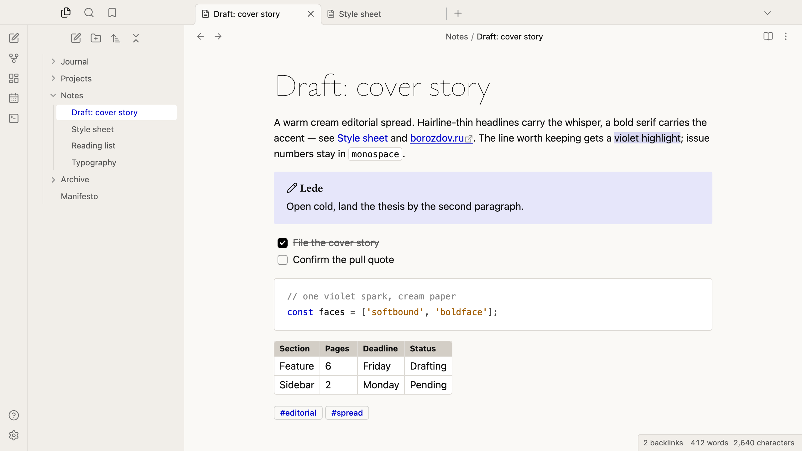
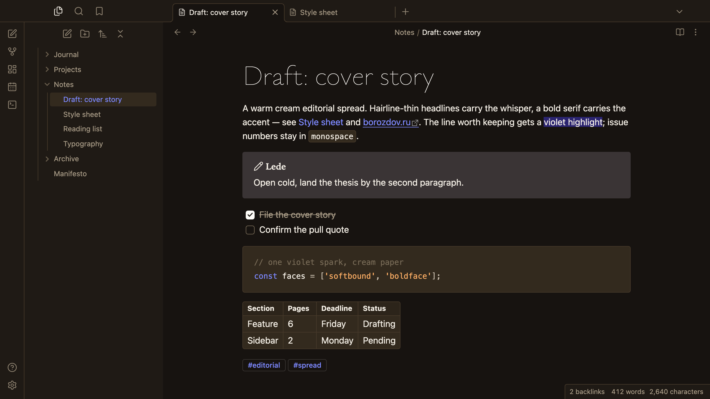

# Borozdov Whisper

A theme from the Borozdov collection. Two faces — light **Softbound**, a warm cream
editorial spread, and dark **Boldface**, the same spread by lamplight. Hairline-thin
headlines carry the whisper, a bold serif carries the accent, and one electric violet
spark is the only saturated colour in the system.

## Principles

- **A whispered voice.** Ysabeau Hairline for the title and every heading, at weight 100
  with tight negative tracking, so a headline reads as one pale shape; it is never bolded
  up. The platform's own sans for the text.
- **One bold answer.** Blockquotes and callout titles switch to a bold serif, a size up —
  the loudest thing on the page, set deliberately against the whisper of the headlines.
- **One electric spark.** Violet appears only in small, functional doses: links, the
  caret, tag outlines and the plain note callout. It never fills a button.
- **Paper, not shadow.** Cards sit one tone above the canvas with sharp 4px corners;
  nothing casts a shadow. The main button is solid black (or, at night, solid cream) —
  never the violet — plain buttons are 4px-cornered outlines.

## Features

- Light and dark modes, following Settings → Appearance → Base color scheme
- Callouts as flat cards with sharp 4px corners; the plain note tinted violet
- Blockquotes in a bold serif, a size up, behind a violet rule
- Tables as bordered cards with sharp 4px corners and a stone-toned header
- Tags as thin violet outlines, never filled
- Quiet editing: no focus ring around the note, its title or form fields while you type;
  property names read as labels, not boxed fields
- Text colours meet WCAG contrast on both faces
- The phone layout keeps the same colours and shapes
- No `!important`: every rule can be overridden with a CSS snippet

## Installation

**From the community directory:** Settings → Appearance → Themes → Manage, search for
**Borozdov Whisper**, then **Install and use**.

**By hand:** download `manifest.json` and `theme.css` from the
[latest release](https://github.com/borozdov-obsidian-themes/whisper/releases/latest) into
`<vault>/.obsidian/themes/Borozdov Whisper/`, then choose Borozdov Whisper under
Settings → Appearance → Themes.

## Font

Ysabeau is embedded in `theme.css` as base64 WOFF2 under the SIL Open Font License 1.1 —
see [`fonts/OFL.txt`](fonts/OFL.txt). It is a Latin and Cyrillic subset of Ysabeau
Hairline (© 2023 The Ysabeau Project Authors), kept under its own name: unlike several
other fonts in this collection, Ysabeau carries no Reserved Font Name, so a modified
(subset) copy may keep it. One weight, for the title and every heading only.

## License

MIT — see [LICENSE](LICENSE).

---

**По-русски.** Тема из коллекции Borozdov. Два лика: светлый «Softbound» — тёплый
редакционный разворот на кремовой бумаге, и тёмный «Boldface» — тот же разворот при
свете лампы. Волосяные заголовки (Ysabeau Hairline) несут шёпот, жирная антиква — ответный
акцент, и один электрический фиолетовый — единственный насыщенный цвет в системе.
Устанавливается из каталога: Настройки → Оформление → Темы → Настроить → Borozdov Whisper →
Установить и применить.
